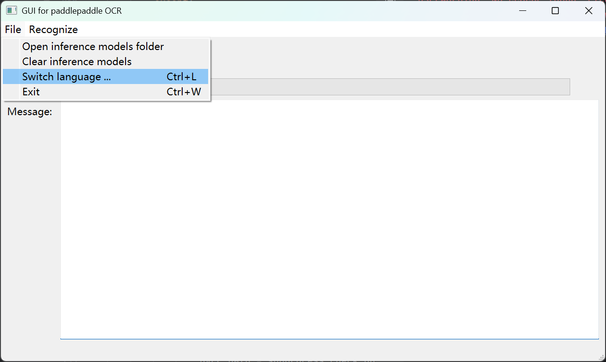
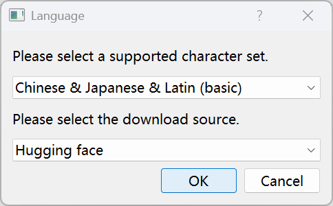
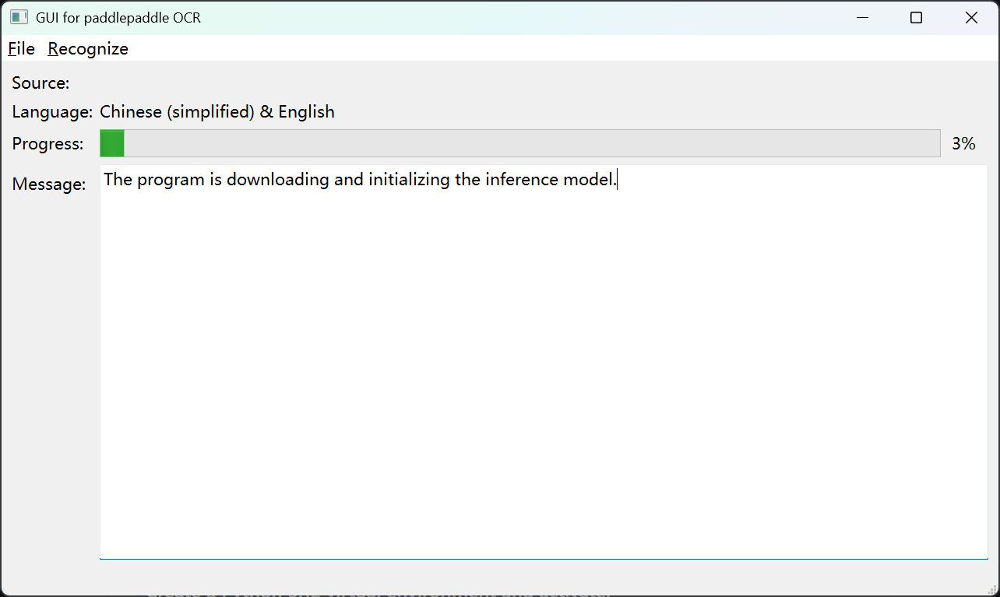
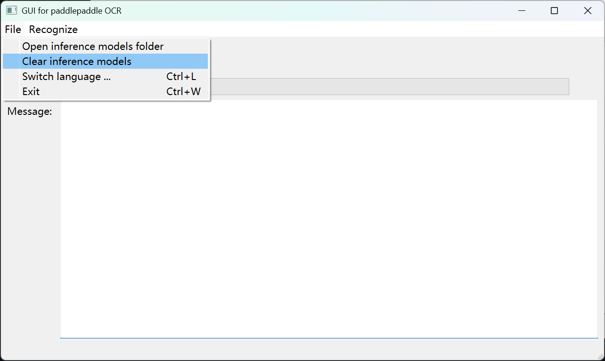
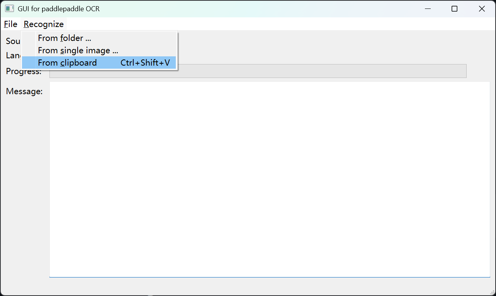

# GUI for `paddlepaddle` OCR

 The GUI for `paddlepaddle` optical character recognition


*Built and tested on Windows 11. Theoretically not introduced features which are specific for Windows 11. Older Windows versions may work but cannot be guaranteed.*

Supported images formats: `.png, .jpg`

Supported source: clipboard, single image, folder of multiple images.

Supported languages (characters sets):

- Chinese & Japanese & Latin (basic)[^1]
- Korean & Latin (basic)
- Tamil
- Telugu
- Kabardian
- Latin (extended)[^4]
- Arabic
- Cyrillic & Latin (basic)
- Devanagari
- Thai & Latin (basic)
- Greek & Latin (basic)
- Latin (basic)

[^1]: Equal to English characters set, or non-space ASCII.
[^4]: Compared to basic Latin, extended Latin misses some punctuations (e.g. no backslash) but has decorated letters (e.g. `Å`).


## Usage

Unzip the latest release and run `GUI for paddlepaddle OCR.exe`

For the first time starting the program, it takes several minutes[^2] before the main window is open and the icon appears in taskbar.

[^2]: Observed in AMD Ryzen 5 5600U, 16GB DDR4 memory, in all PyQt5 programs in Windows 11.

Press `Ctrl + L` or select `File -> Switch language` in the navigation bar.



Select the character set and OCR model's download source. 

Character set: the user has to select one model only, but some models support the mixture of multiple character sets.

Download source: for fastest speed, China mainland users are recommended to download from "Baidu cloud"; all other users are recommended to download from "Hugging face".



Wait while the program is downloading and initializing the OCR model.



>   [!NOTE]
>
>   The user may see connection error. In this case, try the following steps one by one until the initialization is successful. 
>
>   1.   Repeat the "switching language" step and the model will be re-initialized.
>   2.   Choose a different download source.
>   3.   Click `File -> Clear inference models` and repeat step 2, to remove broken files. Alternatively, click "Open inference models folder" and remove broken files manually.
>        


Prepare the image(s), from clipboard, as single file, or as a folder to OCR.



Read the result in the message box.

The progress only shows recognized images over total number of images, so the progress will be either 0% or 100% if recognizing single image from single file or clipboard.


## Install

### From source code

Create a Python 3.12 virtual environment and activate.

Run the following commands in Windows command prompt.

```
pip install -r requirements.txt
pyinstaller main.spec
```


## Acknowledgment

<u>The copyright of the unmodified content of the following content belongs to the original author and covered by the original license. The copyright of modified content are covered by our license. "modified content" means the minimum modified characters in the file that makes the program's behavior different.</u>

[Inference models](https://www.paddleocr.ai/main/version3.x/pipeline_usage/OCR.html) as `inference_models`

[paddleocr](https://github.com/PaddlePaddle/PaddleOCR) (modified) as `paddleocr`

