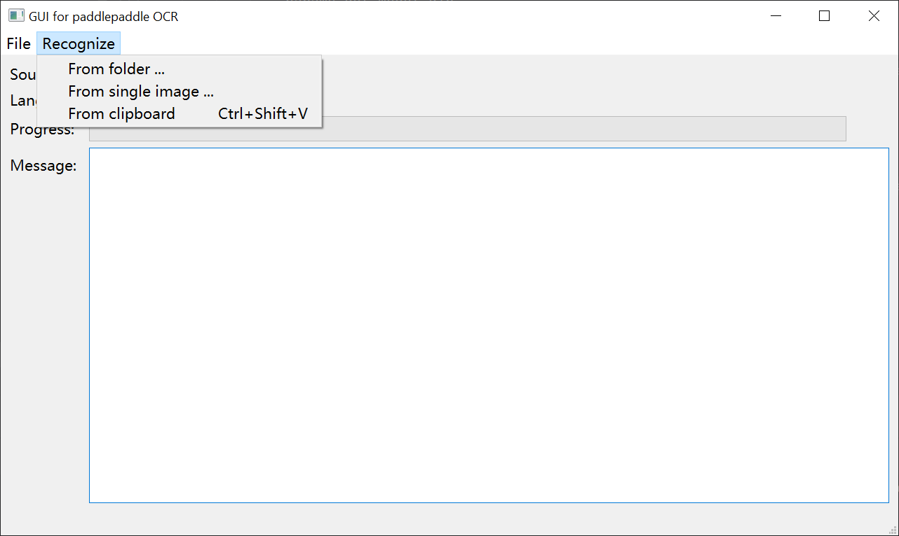

# GUI for `paddlepaddle` OCR

 The GUI for `paddlepaddle` optical character recognition


*Built and tested on Windows 11. Theoretically not introduced features which are specific for Windows 11. Older Windows versions may work but cannot be guaranteed.*

Supported images formats: `.png, .jpg`

Supported source: clipboard, single image, folder of multiple images.

Supported languages (characters sets):

- Chinese (simplified) & English
- English
- Latin [^1]
- Arabic
- Cyrillic
- Devanagari
- Chinese (traditional)
- Korean
- Japan
- Tamil
- Telugu
- Kabardian

[^1]: English characters set equal to non-space ASCII. Latin misses some punctuations (e.g. no backslash) but has decorated letters (e.g. `Å`).





## Usage

Unzip the latest release and run `GUI for paddlepaddle OCR.exe`


## Install (developers)

Create a Python 3.12 virtual environment and activate.

Run the following commands in Windows command prompt.

```
pip install -r requirements.txt
pyinstaller main.spec
```


## Acknowledgment

<u>The copyright of the unmodified content of the following content belongs to the original author and covered by the original license. The copyright of modified content are covered by our license. "modified content" means the minimum modified characters in the file that makes the program's behavior different.</u>

[Inference models](https://github.com/PaddlePaddle/PaddleOCR/blob/release/2.7/paddleocr.py#L72) as `inference_models`

[paddleocr](https://github.com/PaddlePaddle/PaddleOCR) (modified) as `paddleocr`


<!-- https://huggingface.co/PaddlePaddle/PP-OCRv5_mobile_rec/resolve/main/inference.pdiparams -->
