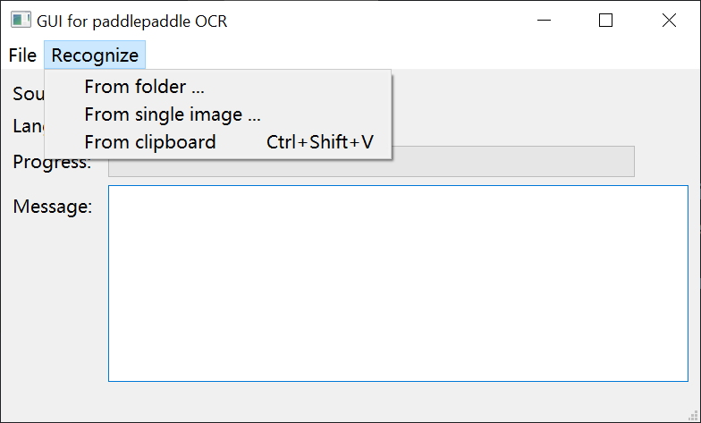

# GUI for `paddlepaddle` OCR

 The GUI for `paddlepaddle` OCR


## Introduction

A Windows GUI to perform optical character recognition using `paddlepaddle` OCR models. With this program, users can recognize text in images from the clipboard or files.

Support recognizing multiple languages' characters from  `*.png` and `*.jpg` images.

Supported languages are listed in `languages.csv`.

<details>
 <summary><b>Screenshot</b></summary>
 
</details>


## Usage

**From release:**

Download and unzip the latest release.

Run `GUI for paddlepaddle OCR.exe`.


**From source code:**

Create a Python 3.11 virtual environment and activate.

Run the following command.

```
pip install -r requirements.txt
pyinstaller main.spec
```


## Acknowledgment

[Inference models](https://github.com/PaddlePaddle/PaddleOCR/blob/release/2.7/paddleocr.py#L72)

<u>Files at the following locations are not in the scope of our license. These locations are dependencies, and not considered as part of this program.</u> 

```
inference_models/
paddleocr/
mklml/
```

